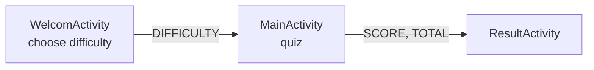

<p align="center">
  
</p>

  

A mental-arithmetic quiz with **three difficulty levels**. Pick easy, medium or hard on the welcome screen, answer a shuffled set of multiple-choice questions, and see your score at the end. The interface is in Uzbek.

## Features

- **30 questions** — 10 each for easy, medium and hard
- **Questions shuffled** every round, so no two runs are the same
- **Four answer options** per question, with the selected answer highlighted
- **Progress counter** (`Savol 3/10`)
- **Result screen** with score out of total

## How it works

Questions are modelled as a small data class:

```kotlin
data class Question(
    val questionText: String,
    val options: List<String>,
    val correctAnswerIndex: Int,
    val difficulty: String // "easy", "medium", "hard"
)
```

The welcome screen passes the chosen difficulty through an `Intent` extra; the quiz screen filters and shuffles the bank (`questions.filter { it.difficulty == selected }.shuffled()`), and the final score is passed on to `ResultActivity` the same way.

## Architecture



## Project structure

```
com.example.matematikatest
├── MainActivity.kt
├── Question.kt
├── ResultActivity.kt
└── WelcomActivity.kt
```

<sub>4 source files · 250 lines of code · 3 layouts</sub>

## Tech stack

| | |
|---|---|
| **Language** | Kotlin |
| **UI** | XML layouts |
| **Min / Target SDK** | 24 / 35 |

## Getting started

```bash
git clone https://github.com/rajabbov/MatematikaTest.git
```

1. Open the folder in **Android Studio** (Ladybug or newer).
2. Let Gradle sync.
3. Run the `app` configuration on a device or emulator.

## Known limitations

- Questions are hard-coded; generating them randomly would make the quiz endless.

---

Made by **Ibrohimjon Rajabboyev** · [@rajabbov](https://github.com/rajabbov)
